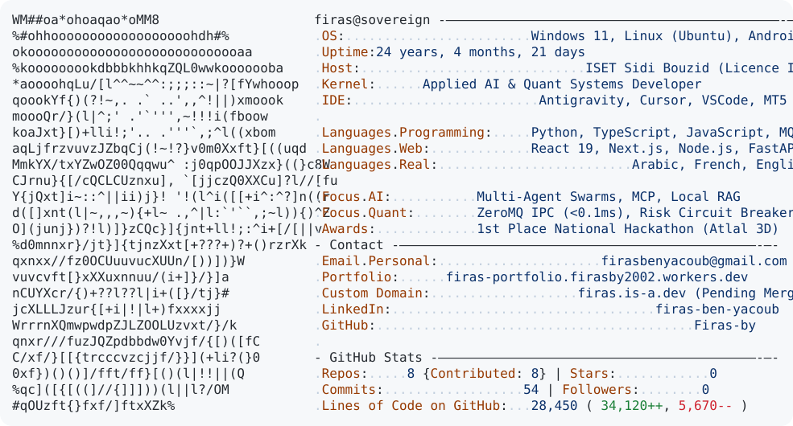

  <a href="https://github.com/Firas-by/Firas-by">
    <picture>
      <source media="(prefers-color-scheme: dark)" srcset="https://raw.githubusercontent.com/Firas-by/Firas-by/main/dark_mode.svg?v=2">
      
    </picture>
  </a>

    

  

    
    &nbsp;
    
    &nbsp;
    
  

### 🔭 Featured Systems & Architectures

* **[TrAIdify / Sovereign](https://github.com/Firas-by/Traidify-Sovereign)** — Dual-process Python &amp; MQL5 quantitative risk execution engine (&lt;0.1ms ZeroMQ IPC, hard 1% drawdown circuit breaker).
* **[TuniBill](https://github.com/Firas-by/TuniBill)** — National electronic invoicing compliance engine enforcing Tunisian Elfatoora (TEIF v1.0) XML canonicalization (C14N) and SHA-256 hash invariant validation.
* **[Project Atlal (أطلال)](https://github.com/Firas-by)** — 1st Place National Hackathon winner: 3D archaeological monument viewer powered by Flutter Impeller 3D engine, MapLibre GL geofencing, and historical RAG exploration.
* **[Developer Portfolio](https://github.com/Firas-by/firas-portfolio)** — React 19, Vite 6, WebGL glyph shaders, and client-side RAG copilot with zero third-party latency.
